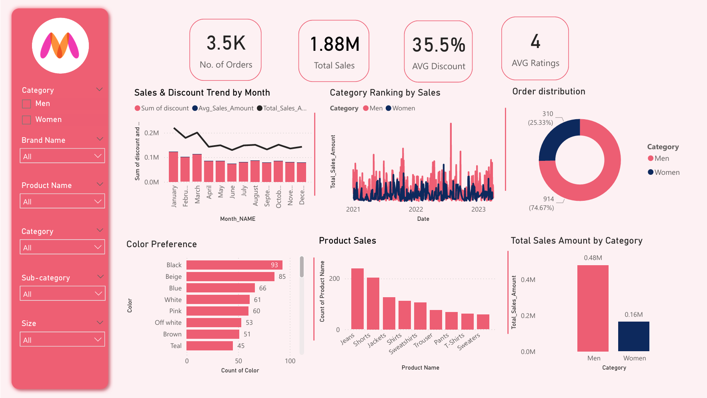
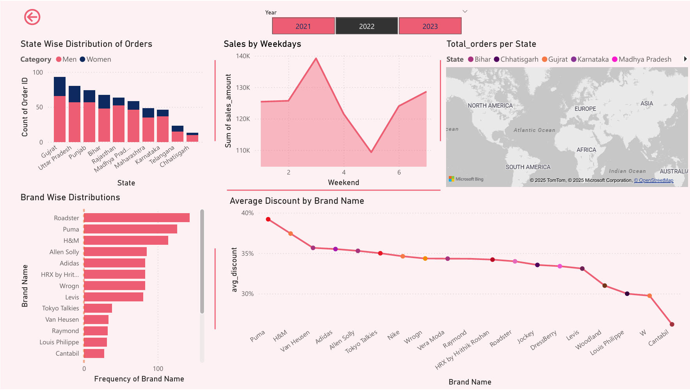

# Myntra Analytics Dashboard

This project analyzes Myntra's sales data to provide key business insights. It evaluates sales performance across various categories, regions, and time periods, and identifies customer preferences and shopping behaviors. The analysis utilizes data visualization techniques to present complex information clearly, enabling effective, data-driven decision-making.

## Screenshot

